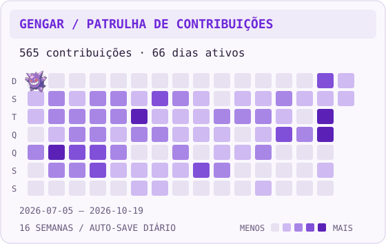

<picture>
  <source media="(prefers-color-scheme: dark)" srcset="assets/terminal-dark.svg">
  
</picture>

Construo APIs, apps e agentes de IA que tiram processos do papel — e da planilha.
Baseado em **Goiânia, Brasil**, com mais de **5 anos** de experiência em sistemas para saúde, vendas e financeiro.

Hoje boa parte do meu trabalho é IA aplicada a produto. O resto ainda é fazer os dados baterem.

[LinkedIn ↗](https://www.linkedin.com/in/raf4el/) · [Explore meus repositórios ↗](https://github.com/rafaelcorreadev1?tab=repositories)

### `01` / Ferramentas por trás do código

**APIs & serviços** — Node.js, Fastify, TypeScript · C#, .NET · Python, FastAPI<br>
**Interfaces** — React, Next.js · React Native, Expo<br>
**Dados & filas** — PostgreSQL, Prisma, SQLAlchemy · Redis, BullMQ<br>
**IA** — LangGraph, LangChain, RAG, tool-calling, guardrails · Gemini, OpenAI<br>
**Infra** — Docker, AWS S3, n8n

### `02` / Por onde passei

**HVSAN** · Software / IA · 2026 — atual<br>
Agente de atendimento no WhatsApp com LangGraph, guardrails determinísticos e arquitetura multi-tenant.

**Pagana** · Full Stack · 2025 — 2026<br>
Vendas de cotas de resort com leitura de documentos por IA, filas BullMQ e eventos em tempo real.

**Selecta Sistemas** · Analista / Full Stack · 2020 — 2025<br>
Faturamento, gestão financeira e conciliação bancária para cooperativas médicas e anestesiologistas.

**SalesBox** · Full Stack · 2024<br>
Integração com TikTok for Business e dashboards de campanha com React, C# e ElasticSearch.

### `03` / Escolha um projeto

**Wagering service** · Go + PostgreSQL + SQS<br>
Carteiras de jogadores movimentadas por HTTP e SQS com o mesmo resultado financeiro, mesmo com várias réplicas e falhas no meio do caminho.<br>
[Repositório →](https://github.com/rafaelcorreadev1/junglegaming)

**Enriquecimento de SKUs** · Node.js + TypeScript + Express<br>
Recebe lotes por webhook, confirma rápido, enriquece cada SKU em segundo plano e entrega o resultado consolidado via callback.<br>
[Repositório →](https://github.com/rafaelcorreadev1/weduu)

**Bot Pizzaria** · React + Node.js + WebSocket + LLM<br>
Atendente virtual com IA em tempo real, histórico com Prisma, Docker e testes automatizados.<br>
[Repositório →](https://github.com/rafaelcorreadev1/bot-pizzaria)

**SEO Lab — TechStore** · Next.js + TypeScript<br>
E-commerce de estudo de SEO técnico: catálogo, busca, filtros, paginação e sacola que sobrevive ao refresh.<br>
[Repositório →](https://github.com/rafaelcorreadev1/seo-lab)

### `04` / Depois do commit

Conheça o **Byte**, o robozinho que patrulha meu gráfico de contribuições. Cada quadrado aceso é um dia com contribuição; quanto mais forte, mais atividade.

<picture>
  <source media="(prefers-color-scheme: dark)" srcset="assets/contributions-dark.svg">
  
</picture>

<sub>16 semanas de atividade real · atualizado diariamente · um replay animado, sem controles.</sub>

<details>
<summary><code>./side-quest</code> — um bug antes de você ir</summary>

O provedor deu timeout e reenviou o mesmo evento. O jogador ganhou o prêmio **duas vezes**. Onde está o erro?

```ts
app.post("/webhook", async (req, res) => {
  const { playerId, amount } = req.body;
  await wallet.credit(playerId, amount);
  res.sendStatus(200);
});
```

<details>
<summary>Revelar a correção</summary>

Webhooks são entregues *pelo menos uma vez*, não *exatamente uma vez*. Torne a operação idempotente com o ID do evento e uma constraint única, na mesma transação do crédito:

```ts
app.post("/webhook", async (req, res) => {
  const { eventId, playerId, amount } = req.body;
  await db.transaction(async (tx) => {
    const inserted = await tx.processedEvents.insertIgnore({ eventId });
    if (!inserted) return;
    await tx.wallet.credit(playerId, amount);
  });
  res.sendStatus(200);
});
```

Mesmo evento, mesmo resultado — não importa quantas vezes ele chegue.

**Bug corrigido. O financeiro agradece.**

</details>
</details>

---

**Tem um processo manual pra automatizar ou um agente de IA pra colocar em produção?**<br>
Aberto a oportunidades full stack e de IA aplicada. [Vamos conversar no LinkedIn →](https://www.linkedin.com/in/raf4el/)

<!-- Você inspecionou o código-fonte. Provavelmente vamos nos dar bem. -->
